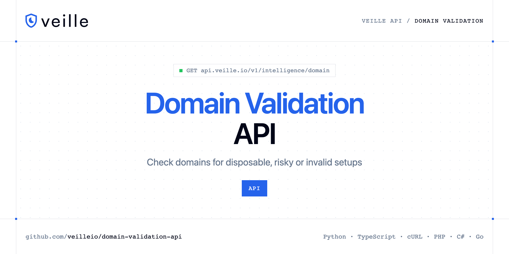

<p align="center">
  <a href="https://www.veille.io"></a>
</p>

# Domain Validation API

[](https://discord.gg/CFj3ph8aHU) [](https://app.veille.io/register) [](https://app.veille.io/openapi) [](LICENSE)

The **Veille Domain Validation API** checks a domain so you can spot disposable, misconfigured or risky domains.

- **Domain Validation API** — Check any domain instantly.

Use it for sign-up protection, B2B lead validation and fraud prevention.

| Endpoint | Request | Credits |
|---|---|---|
| [Domain Validation API](#domain-validation-api) | `GET /v1/intelligence/domain` | 2 |

## Table of contents

- [How it works](#how-it-works)
- [Domain Validation API](#domain-validation-api)
- [Code examples in other languages](#code-examples-in-other-languages)
- [Use cases](#use-cases)
- [Why Veille?](#why-veille)
- [FAQ](#faq)
- [Official SDKs](#official-sdks)
- [Related repositories](#related-repositories)
- [Support](#support)

## How it works

1. **Create a Veille account** and copy your API key from the [dashboard](https://app.veille.io/register).
2. **Call `https://api.veille.io`** with the header `x-api-key: YOUR_API_KEY`.
3. **Use the result** in your app — no infrastructure to run.

```bash
export VEILLE_API_KEY="your-api-key"
pip install requests        # Python
# TypeScript: Node.js 18+ (native fetch), run with `npx tsx file.ts`
```

## Domain Validation API

Check any domain instantly. Detects disposable email providers, public webmail, relay services, and education domains. Returns DNS health with MX provider detection, domain history, and optional SSL/TLS certificate transparency.

`GET https://api.veille.io/v1/intelligence/domain` · **2 credits per request** · [API reference](https://app.veille.io/openapi)

### Request parameters

| Parameter | In | Type | Required | Description |
|---|---|---|---|---|
| `query` | query | string | ✅ | The domain to validate. Accepts raw domains (`tempmail.org`), full URLs (`https://www.tempmail.org/page`), or domains with `www.` prefix, all are normalized automatically. |
| `certificate_transparency` | query | boolean | — | Enable Certificate Transparency lookup. Returns SSL/TLS certificate history, current certificate, issuers, and all Subject Alternative Names (SANs) ever associated with the domain. Adds 1-5 seconds of latency. |

### Python example

```python
import os

import requests

API_KEY = os.environ["VEILLE_API_KEY"]
HEADERS = {"x-api-key": API_KEY}

response = requests.get(
    "https://api.veille.io/v1/intelligence/domain",
    headers=HEADERS,
    params={
        "query": "tempmail.org",
    },
    timeout=120,
)
response.raise_for_status()

data = response.json()
print(data)
```

### TypeScript example

```typescript
type DomainValidationApi = {
  dns?: {
    mx?: boolean;
    spf?: string;
    dmarc?: unknown;
    spf_valid?: boolean;
    mx_records?: {
      hostname?: string;
      priority?: number;
    }[];
    dmarc_valid?: boolean;
    mx_providers?: unknown[];
  };
  tags?: string[];
  whois?: {
    registrar?: string;
    updated_date?: string;
    creation_date?: string;
    expiration_date?: string;
  };
  domain?: string;
  sources?: string[];
  education?: boolean;
  last_seen?: string;
  disposable?: boolean;
  first_seen?: string;
  is_subdomain?: boolean;
  relay_domain?: boolean;
  public_domain?: boolean;
  domain_age_days?: number;
};

const headers = { "x-api-key": process.env.VEILLE_API_KEY!, "Content-Type": "application/json" };

const params = new URLSearchParams({
  "query": "tempmail.org",
});

const response = await fetch(`https://api.veille.io/v1/intelligence/domain?${params}`, { headers });
if (!response.ok) throw new Error(`HTTP ${response.status}: ${await response.text()}`);

const data = (await response.json()) as DomainValidationApi;
console.log(data);
```

### Output example

Example response from the API reference, abridged.

```json
{
  "dns": {
    "mx": true,
    "spf": "v=spf1 include:_spf.tempmail.org ~all",
    "dmarc": null,
    "spf_valid": true,
    "mx_records": [
      {
        "hostname": "mx1.tempmail.org",
        "priority": 10
      }
    ],
    "dmarc_valid": false,
    "mx_providers": []
  },
  "tags": [
    "disposable"
  ],
  "whois": {
    "registrar": "Namecheap, Inc.",
    "updated_date": "2024-08-20",
    "creation_date": "2023-09-15",
    "expiration_date": "2025-09-15"
  },
  "domain": "tempmail.org",
  "sources": [
    "disposable-email-domains"
  ],
  "education": false,
  "last_seen": "2026-02-18",
  "disposable": true,
  "first_seen": "2024-03-12",
  "is_subdomain": false,
  "relay_domain": false,
  "public_domain": false,
  "domain_age_days": 892
}
```

### Response fields

| Field | Type | Description |
|---|---|---|
| `dns` | object |  |
| `dns.mx` | boolean |  |
| `dns.spf` | string |  |
| `dns.dmarc` | object |  |
| `dns.spf_valid` | boolean |  |
| `dns.mx_records[]` | object[] |  |
| `dns.dmarc_valid` | boolean |  |
| `dns.mx_providers` | any[] |  |
| `tags` | string[] |  |
| `whois` | object |  |
| `whois.registrar` | string |  |
| `whois.updated_date` | string |  |
| `whois.creation_date` | string |  |
| `whois.expiration_date` | string |  |
| `domain` | string |  |
| `sources` | string[] |  |
| `education` | boolean |  |
| `last_seen` | string |  |
| `disposable` | boolean |  |
| `first_seen` | string |  |
| `is_subdomain` | boolean |  |
| `relay_domain` | boolean |  |
| `public_domain` | boolean |  |
| `domain_age_days` | integer |  |

## Code examples in other languages

Ready-to-run examples live in [`examples/`](examples); each reads your key from `VEILLE_API_KEY`.

| Language | `intelligence-domain` |
|---|---|
| cURL (Bash) | [intelligence_domain.sh](examples/curl/intelligence_domain.sh) |
| PHP | [intelligence_domain.php](examples/php/intelligence_domain.php) |
| C# | [IntelligenceDomain.cs](examples/csharp/IntelligenceDomain.cs) |
| Go | [intelligence_domain.go](examples/go/intelligence_domain.go) |
| Java | [IntelligenceDomainExample.java](examples/java/IntelligenceDomainExample.java) |
| Ruby | [intelligence_domain.rb](examples/ruby/intelligence_domain.rb) |
| Node.js | [intelligence_domain.mjs](examples/nodejs/intelligence_domain.mjs) |

## Use cases

- **Sign-up protection** — Block disposable email domains.
- **B2B validation** — Check company domains of new leads.

## Why Veille?

- **Stop fake sign-ups** — validate emails and domains before creating accounts.
- **Block abuse** — check IP reputation to stop bots and automated attacks.
- **Clean billing data** — validate VAT numbers and IBANs, get exchange rates.
- **Fast** — designed to run inline in sign-up and checkout flows.
- **Copy-paste examples** — Python and TypeScript in each README, 7 more languages in `examples/`.

## FAQ

### How do I authenticate?

Create an account on [Veille](https://app.veille.io/register), copy your API key and send it in the `x-api-key` header of every request to `https://api.veille.io`.

### How much does a request cost?

Credits per call: `/v1/intelligence/domain` **2**. See [Veille pricing](https://www.veille.io/pricing).

### Which languages are supported?

Any language that can make an HTTP request. This README shows Python and TypeScript; the [`examples/`](examples) folder contains cURL, PHP, C#, Go, Java, Ruby and Node.js.

## Official SDKs

Use Veille from your own language with a typed client:

| SDK | Package | Install |
| --- | --- | --- |
| Node.js | [`@veilleio/sdk`](https://www.npmjs.com/package/@veilleio/sdk) | `npm install @veilleio/sdk` |
| Python | [`veille`](https://pypi.org/project/veille/) | `pip install veille` |
| Go | [`veille-go`](https://pkg.go.dev/github.com/veilleio/veille-go) | `go get github.com/veilleio/veille-go` |
| .NET | [`Veille`](https://www.nuget.org/packages/Veille) | `dotnet add package Veille` |
| Ruby | [`veille`](https://rubygems.org/gems/veille) | `gem install veille` |
| PHP | [`veille/sdk`](https://packagist.org/packages/veille/sdk) | `composer require veille/sdk` |
| Java | [`veille-java`](https://github.com/veilleio/veille-java) | build from source, see its README |
| CLI | [`@veilleio/cli`](https://www.npmjs.com/package/@veilleio/cli) | `npm install -g @veilleio/cli` |
| MCP server | [`@veilleio/mcp`](https://www.npmjs.com/package/@veilleio/mcp) | `npx -y @veilleio/mcp` |

## Related repositories

- [Email Validation API](https://github.com/veilleio/email-validation-api)
- [Email Qualification API](https://github.com/veilleio/email-qualification-api)
- [IP Reputation API](https://github.com/veilleio/ip-reputation-api)
- [VAT Validation API](https://github.com/veilleio/vat-validation-api)
- [IBAN Validation API](https://github.com/veilleio/iban-validation-api)
- [Exchange Rates API](https://github.com/veilleio/exchange-rates-api)
- [All Veille repositories](https://github.com/veilleio)

## Support

- 💬 Join the [Discord](https://discord.gg/CFj3ph8aHU) to ask questions and share what you build.
- 📚 Read the [API reference](https://app.veille.io/openapi).
- 🔑 [Get your API key](https://app.veille.io/register).

---

<p align="center">
  <a href="https://www.veille.io">
    <picture>
      <source media="(prefers-color-scheme: dark)" srcset="images/logo-dark.svg">
      
    </picture>
  </a>
  <br>
  <sub>Built by <a href="https://www.veille.io">Veille</a>. Examples are released under the MIT license.</sub>
</p>
